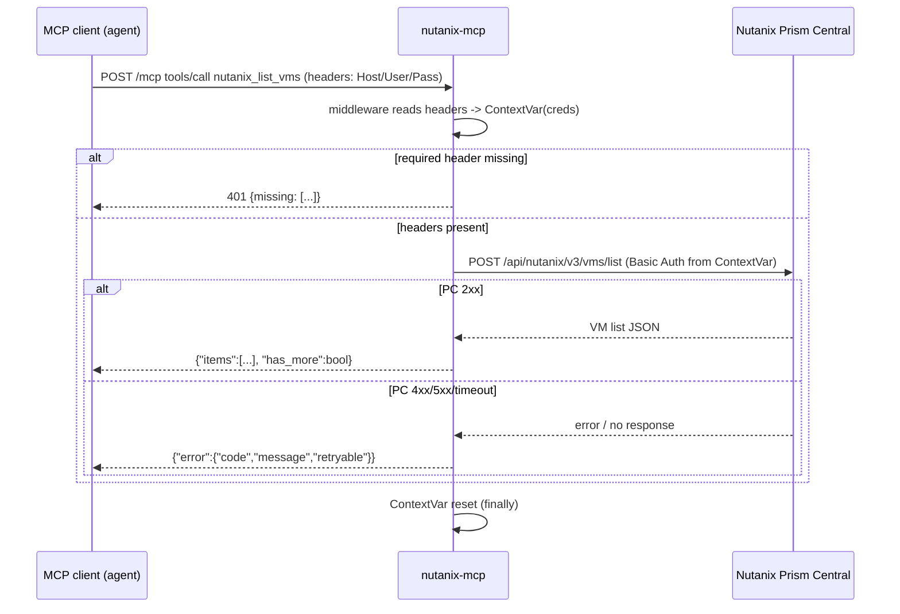

# PRD-21347 · [Infrastructure] Nutanix

Ticket: https://app.clickup.com/t/86e3v6wnh
Repo: https://github.com/MSPbotsAIFramework/nutanix-mcp@main (69c492f)
Work branch: dev/PRD-21347
Status: frozen @ 66b057a

## Requirement understanding

One line: Connect Nutanix as an MCP server so Claude, ChatGPT, Cursor, or any MCP-compatible AI agent can get live access to a customer's Nutanix environment, with credentials encrypted in transit and every action logged.

The ticket is a one-line ask with a reference link to a third-party catalog entry (`https://conduit.wyre.ai/plugins/nutanix`, Conduit's own marketplace listing for a Nutanix plug-in). It names no specific tool, no bug, and no acceptance criteria of its own — it is a request to build a new vendor MCP connector for Nutanix from scratch. The Conduit link is read only as a pointer to "what Nutanix is" (a hyperconverged infrastructure / private-cloud platform); it is not a spec, and this design does not copy Conduit's tool surface — Conduit's own tool list is not public without installing their plug-in, so the actual source of truth used below is Nutanix's own public API documentation (see Sources).

## Current state

- `MSPbotsAIFramework/nutanix-mcp` exists as an empty scaffold: one commit (`69c492f`, "Initial commit"), `README.md` only, no source code, no tools, no tests, no Dockerfile (`README.md:1-2` — "# nutanix-mcp" / "MCP server for Nutanix"). The repo was created manually by an org admin on 2026-11-02 after a prior design attempt (dev03, PRD-21347 comment `1600390000020528`) hit a GitHub permission error trying to create it via the API.
- No other MCP repo in `MSPbotsAIFramework` covers Nutanix or Nutanix Prism: `mbp.py mcplock info --repo nutanix-mcp` confirms the repo is live with default branch `main`; the prior design attempt's org-wide name search (`nutanix`, `nutanix-mcp`, `prism`, `prism-central`, `nutanix-prism`) found no other candidate (the only `prism` hits in the org were the unrelated `prismjs` / `prisma` npm packages in `mb-platform-agent`, confirmed by file inspection, not Nutanix Prism Central).
- This is therefore main line A of the vendor-mcp-development skill (new MCP service, first version) even though the empty repo already exists — there is nothing to extend, only to build.

## Sources

- Ticket `text_content` (PRD-21347), read 2026-11-02.
- Ticket comment history (PRD-21347): dev03's `[BLOCKED · vendor-mcp]` comment (`1600390000020528`) and Cavin Lang's repo-created comment (`1600390000023310`), read 2026-11-02.
- Code: `MSPbotsAIFramework/nutanix-mcp@main (69c492f)` — `README.md` only.
- wiki: `mbp.py wiki find` — no hit for "Nutanix" (`ProductDocs` does not cover this connector yet; this is the first MCP connector for this vendor). `ProductDocs/_connector-fields.md § 变体 1 —— 凭据式` (_verified_ dates vary by row, table itself current as of the 2026-10 patrol) confirms the established pattern for on-prem/API-key style connectors on this platform: a credential-style connection form with Base URL / Server URL + Username + Password, or Base URL + API Key (e.g. HaloPSA, ConnectWise Automate, Nextiva) — used below only as a precedent for what headers the eventual platform-side connector form is likely to collect, not as a requirement this repo enforces.
- Nutanix public developer portal, fetched 2026-11-02: `https://www.nutanix.dev/` and `https://www.nutanix.dev/api-reference/` confirm Prism Central REST API v3 is public, self-service, no login/partner gate ("Prism Central v3 API, allowing read and write control over registered clusters and various Prism Central services"); `https://www.nutanix.dev/api-reference-v4/` lists 16 GA v4 namespaces (`vmm.v4`, `clustermgmt.v4`, `networking.v4`, `iam.v4`, …) but the fetched pages do not expose authentication details or exact paths — those require developers.nutanix.com account-free browsing at implementation time (see Risks).

## Product design

### Goals / Non-goals

**Goals:**
- Give any MCP-compatible agent (Claude, ChatGPT, Cursor, or the MSPbots Agent platform itself) live, read-mostly access to a customer's Nutanix Prism Central environment: clusters, hosts, VMs, images, subnets, tasks, and alerts.
- Allow one bounded, high-value write action — VM power control (on / off / soft shutdown / reboot) — because "live access" for an infra product that stops at read-only is not actually useful to an operator agent, and this is the one write action every comparable on-prem connector in this space exposes first.
- Credentials are supplied per request (platform passes them from whatever the customer configured) and are never persisted, logged, or shared across requests — "encrypted" credential handling in the ticket's own words, translated into this platform's existing contract: credentials travel only in request headers (SOP §3.1), the connector never has a private copy.
- Every tool call is logged with enough structure (vendor, tool, resource id, outcome) to answer "who/what touched this Nutanix cluster and when" after the fact — this is the "every action logged" half of the ask.

**Non-goals (this version):**
- No UI or agent-platform-side changes. Registering the connector on INT, building the connection form, and showing it in `/dev/published-connectors` are platform responsibilities outside this repo (confirmed by `ProductDocs/18-Dev.md § Published Connectors`); this ticket only builds and publishes the MCP server.
- No coverage of Nutanix products outside core Prism Central infrastructure management: no Nutanix Files, Objects, Era/NDB, Move, Calm/Self-Service, licensing, or multi-cluster DR orchestration. These are separate products with separate APIs; adding them is new scope for a follow-up ticket.
- No VM lifecycle beyond power control: no create/clone/delete/resize VM, no snapshot/restore, no network reconfiguration. These are higher-risk destructive or stateful operations that deserve their own design and explicit product sign-off.
- No Prism Element (single-cluster, pre-Prism-Central) API support — Prism Central is the multi-cluster manager and is what "connect it" implies for a platform-level connector.
- No v4 API in this version (see Tech design § Option analysis) — v4 namespace coverage is deferred.

### Acceptance criteria

- **AC1**: Given valid Nutanix Prism Central connection details (host + username + password) in the request headers, When an MCP client calls `initialize` then `tools/list`, Then the server returns the Nutanix tool set (all `nutanix_*` tools, each with a description and typed parameters) without contacting Prism Central.
- **AC2**: Given one or more of the required credential headers is missing, When any tool is called, Then the server returns HTTP 401 with a body listing the specific missing header name(s), and no request is made to Prism Central.
- **AC3**: Given valid credentials for a reachable Prism Central, When `nutanix_list_vms` is called with no arguments, Then it returns up to 50 VMs (name, uuid, power_state, cluster reference) and `has_more: true` if more exist.
- **AC4**: Given a valid VM UUID, When `nutanix_power_vm` is called with action `on` | `off` | `soft_shutdown` | `reboot`, Then Prism Central's power transition is triggered and the tool returns the Nutanix task UUID for polling via `nutanix_get_task`; given a UUID that does not exist on the cluster, Then the tool returns a structured `not_found` error instead of a 500 or a raw stack trace.
- **AC5**: Given Prism Central rejects the credentials (401/403) or fails with a 5xx/timeout, When any tool is called, Then the tool returns the structured error envelope (`{"error":{"code","message","retryable"}}`) with `code` = `unauthorized` or `upstream_error` respectively — never an unhandled exception.
- **AC6**: Given two concurrent requests carry different Prism Central hosts/credentials (two different customers, or the same customer rotating credentials), When tools are invoked concurrently, Then neither request's credentials or results are observable from the other's context (request-scoped isolation, no shared client/cache keyed only by process-global state).
- **AC7**: Given a Prism Central with a self-signed TLS certificate (the Nutanix on-prem default) and the optional "skip verification" header is not set, When any tool connects, Then the TLS failure is reported as a clear `upstream_error`, not silently ignored; given the header is explicitly set to disable verification, Then the connection succeeds.
- **AC8**: Given no `limit` is passed to a list tool, When it executes, Then it defaults to 50 results; given a caller asks for `limit > 200`, Then the tool caps the request at 200 rather than passing an unbounded value upstream.
- **AC9**: Given `/health` is called, Then it returns `200 {"status":"ok"}` without needing Prism Central credentials or connectivity (local liveness only, per SOP §1.1).

### Open questions

- [不阻塞] Exact Prism Central v3 `/vms/{uuid}` power-state update semantics (full-spec PUT vs a dedicated power endpoint) need confirming against the live v3 OpenAPI/Swagger spec at implementation time — assumed as the documented read-modify-write pattern (Tech design § Option analysis). Does not block this design; if the real endpoint shape differs, AC4's contract (task UUID returned) does not change.
- [已假设] Assumed v3, not v4, for the first version (Tech design § Option analysis explains why). If product later requires v4-only features (e.g. finer-grained IAM-scoped API keys), a follow-up ticket adds a `v4` tool variant; this does not require reworking AC1–AC9.
- [不阻塞] Storage container listing (`nutanix_list_storage_containers`) may live under the Groups API rather than a flat REST collection in v3 — exact path to be confirmed against the spec at dev time; functionally this is still a read-only list tool and does not change the product-facing behavior.

## Tech design

### Conclusion

Build the first version of `nutanix-mcp` as a stateless Streamable-HTTP MCP server (Python 3.12, FastMCP, following the vendor-mcp-development SOP skeleton) that proxies a bounded set of Nutanix Prism Central v3 REST API calls. Credentials (host, username, password, optional TLS-verify flag) come only from request headers, one Nutanix HTTP client is built per request from those headers, and every Nutanix API error is translated into the platform's structured error envelope. This is the natural shape for this repo — there is no existing code to extend, and the vendor-mcp-development skill's skeleton is the established pattern every other connector in `MSPbotsAIFramework` already follows.

### Where the current implementation lives

Nowhere yet. `README.md:1-2` is the entire repo. This section exists to say so explicitly rather than skip it — there is no "current behavior" to describe because none is implemented.

The nearest reference implementations for shape (not for Nutanix-specific content) are the other Header-credential, request-scoped connectors already live in `MSPbotsAIFramework` (the vendor-mcp-development SOP `§3` contract is written from their pattern); this repo follows the same skeleton rather than inventing a new one.

### Option analysis

**API version — v3 vs v4:**

| Option | What | Pros | Cost | Verdict |
|---|---|---|---|---|
| Prism Central v3 | `/api/nutanix/v3/<kind>/list` (POST, common list body: `kind`, `length`, `offset`, `filter`) + `/api/nutanix/v3/<kind>/{uuid}` (GET) | Public, documented, no partner/paywall gate (confirmed by the prior design attempt and by `nutanix.dev`); stable for years; every `kind` needed for this ticket's scope (`vms`, `clusters`, `hosts`, `images`, `subnets`, `tasks`, `alerts`) is covered; auth is plain HTTP Basic (PC admin or a scoped role account), available on every supported Prism Central version | Nutanix is steering new work toward v4; v3 is the older surface | **Chosen** |
| Prism Central v4 | Per-namespace REST (`vmm.v4`, `clustermgmt.v4`, …), OpenAPI-described, supports PC-generated API keys as an alternative to Basic Auth | "Recommended" per Nutanix's own developer portal (2026-11) | The two fetched overview pages (`api-reference-v4`) do not expose exact paths, request/response shapes, or auth header names — those sit behind `developers.nutanix.com`'s interactive docs that were not fetched for this design (see Open questions / Risks); building against unverified endpoints risks exactly the "编造路径" failure this skill's quality line forbids | Deferred to a follow-up ticket once the exact v4 contract is confirmed |

No real third option: an open-source Nutanix MCP server was not found in the search that led to this ticket being flagged as a new-connector request (if one existed under a different name, it was not surfaced to this design and vendor-mcp-development skill rule 3 would still require reimplementing it in `MSPbotsAIFramework`, not forking it).

**Auth shape — Basic Auth vs API key (`Decisions made by DEV01`, see below):** chose Basic Auth (username + password headers) over PC-generated API keys because Basic Auth works on every Prism Central version the customer base might run, while API keys require PC 2022.6+; this connector should not silently fail for customers on older PC releases.

### Decisions made by DEV01

No one was available to ask (unattended design run). Choices made for this first version, each reversible in a follow-up ticket without breaking AC1–AC9:

- **v3 over v4** — see Option analysis. Alternative: v4, rejected for this version because its exact contract was not verifiable without fetching developers.nutanix.com's interactive spec, which this design pass did not do; building against an unverified v4 path risks shipping a connector that 404s on day one.
- **Basic Auth (username/password) over PC API keys** — works on all supported PC versions; alternative (API key only) would exclude customers on PC < 2022.6. A follow-up could add API-key support as an alternative credential set once a customer actually needs it.
- **TLS verification on by default, opt-out via header** — Nutanix on-prem deployments commonly run self-signed certificates (AC7); defaulting to "verify" is the safe default per SOP §11, and the opt-out is explicit and per-request rather than a repo-wide config flag, consistent with "credentials/connection details only from headers, no env fallback" (SOP §3.1 extended here to the one non-secret connection detail that is genuinely per-deployment).
- **Tool scope: 12 read tools + 1 write tool (power control)** — covers the infra-visibility and the one write action named implicitly by "live access"; explicitly excludes VM create/delete/snapshot and non-compute Nutanix products (Files, Objects, Era) as a deliberate first-version boundary (Non-goals). Alternative considered: ship read-only tools only; rejected because a connector that can only look and never act does not match "live access" as described in the ticket, and VM power-cycling is the lowest-risk, most universally useful write action for this product category.
- **Pagination default 50 / hard cap 200** — per SOP §2 token-economy rule, independent of whatever cap Prism Central's own API allows natively.

### Change list

All paths are new (empty repo):

- `pyproject.toml` [new] — Python 3.12 project, `fastmcp`, `httpx`, `pydantic`, `pydantic-settings`; dev deps `pytest`, `pytest-asyncio`, `respx` (HTTP mocking for the auto test cases below).
- `src/nutanix_mcp/__init__.py` [new]
- `src/nutanix_mcp/server.py` [new] — FastMCP app, `stateless_http=True`, `TransportSecuritySettings(enable_dns_rebinding_protection=False)`, mounts `/mcp`, defines `GET /health`.
- `src/nutanix_mcp/middleware.py` [new] — reads `X-Nutanix-Host`, `X-Nutanix-Username`, `X-Nutanix-Password`, optional `X-Nutanix-Verify-Ssl`; 401 with the missing-header list when required ones are absent; stores a per-request `NutanixCredentials` in a `contextvars.ContextVar`, `reset()` in a `finally`.
- `src/nutanix_mcp/client.py` [new] — thin `httpx.AsyncClient` wrapper built fresh per request from the context var's credentials; base URL `https://{host}:9440` (default port, only appended if the host header has no explicit port); connect timeout 5s / read timeout 30s; retry with backoff on 429/5xx honoring `Retry-After`, capped so one tool call's total retry time stays under 120s (SOP §5).
- `src/nutanix_mcp/errors.py` [new] — maps Nutanix's own error shape (`{"api_version","code","kind":"error","message_list":[{"message","reason"}]}`) and transport failures (TLS, timeout, connection refused) to the envelope `{"error":{"code","message","retryable"}}`; `code` vocabulary: `not_configured` (never reached here — headers checked by middleware), `unauthorized`, `not_found`, `invalid_argument`, `rate_limited`, `upstream_error`.
- `src/nutanix_mcp/tools/vms.py` [new] — `nutanix_list_vms`, `nutanix_get_vm`, `nutanix_power_vm`.
- `src/nutanix_mcp/tools/clusters.py` [new] — `nutanix_list_clusters`, `nutanix_get_cluster`.
- `src/nutanix_mcp/tools/hosts.py` [new] — `nutanix_list_hosts`, `nutanix_get_host`.
- `src/nutanix_mcp/tools/images.py` [new] — `nutanix_list_images`.
- `src/nutanix_mcp/tools/subnets.py` [new] — `nutanix_list_subnets`.
- `src/nutanix_mcp/tools/storage.py` [new] — `nutanix_list_storage_containers` (path to confirm at dev time, Open questions).
- `src/nutanix_mcp/tools/tasks.py` [new] — `nutanix_get_task`.
- `src/nutanix_mcp/tools/alerts.py` [new] — `nutanix_list_alerts`.
- `tests/test_tools.py` [new] — `tools/list` snapshot, happy-path + error-mapping tests per tool (respx-mocked Prism Central).
- `tests/test_middleware.py` [new] — missing-header 401, context isolation across concurrent requests.
- `Dockerfile` [new] — multi-stage, non-root, `curl` installed, `EXPOSE 8080`, `HEALTHCHECK` against `/health`.
- `README.md` [modify] — replace the placeholder with product description, the Header credential table, the MSPbots Connector section (`reference/readme-connector-section.md`, copied verbatim), and the tool table.
- `.env.example`, `.gitignore`, `.dockerignore` [new].

### Reuse & cleanup

- **Reuse**: the entire shape (stateless FastMCP app, header-credential middleware, contextvar isolation, error envelope, `/health` endpoint) is the vendor-mcp-development SOP skeleton that every sibling connector in `MSPbotsAIFramework` already implements — this is not a new pattern, it is the Nth instance of an established one. `httpx` is already the SOP-recommended HTTP client for this skeleton (SOP §5 talks in `httpx` terms); no reason to pick anything else.
- **New dependencies**: `fastmcp` (MCP server framework, SOP-mandated), `httpx` (async HTTP client with native retry/timeout support, replaces hand-rolling `urllib`/`requests` + retry logic), `pydantic-settings` (typed, `extra="ignore"` config, SOP §1.2), dev-only `respx` (HTTP-level mocking so the auto test cases below don't need a live Prism Central). All are the same choices every other connector in this org already made; no self-written alternative considered.
- **API / signature shape**: every list tool takes the same optional `(filter: str | None, limit: int = 50, offset: int = 0)` shape rather than a bespoke parameter set per tool, so an agent that has learned one list tool already knows the others; `nutanix_power_vm(vm_uuid: str, action: Literal["on","off","soft_shutdown","reboot"])` uses a closed enum rather than a free-text action string.
- **This-ticket cleanup**: none — the repo has nothing to clean up (one README, one commit).
- **Suggested follow-ups (out of scope here)**: v4 migration once its contract is verified; VM lifecycle (create/delete/snapshot) and non-compute Nutanix products, each as their own ticket with their own product sign-off given the higher blast radius of those operations.

### Data & API contract

**Transport**: `POST /mcp` (Streamable HTTP, JSON-RPC 2.0 MCP protocol), `GET /health`.

**Request headers** (all connector-specific; none read from environment variables):

| Header | Required | Meaning |
|---|---|---|
| `X-Nutanix-Host` | Yes | Prism Central hostname or IP, optionally `host:port`; defaults to port `9440` if omitted |
| `X-Nutanix-Username` | Yes | Prism Central account username (any role with read access to the resources below; write access required to call `nutanix_power_vm`) |
| `X-Nutanix-Password` | Yes | Prism Central account password |
| `X-Nutanix-Verify-Ssl` | No | `"true"` (default) or `"false"`; set to `"false"` to accept self-signed/untrusted certificates on-prem Prism Central commonly presents |

Missing `Host` / `Username` / `Password` → `401` with a JSON body `{"error":"missing_headers","missing":["X-Nutanix-Host", ...]}`.

**Tools** (all names `nutanix_<verb>_<resource>`, descriptions ≤ 500 chars / first line ≤ 100 chars per SOP §2):

| Tool | Params | Returns | Hints |
|---|---|---|---|
| `nutanix_list_vms` | `filter?`, `limit?` (≤200, default 50), `offset?` | `{"items":[{uuid,name,power_state,cluster_uuid,cluster_name}], "has_more":bool}` | readOnly |
| `nutanix_get_vm` | `vm_uuid` | full VM detail (spec+status) | readOnly |
| `nutanix_power_vm` | `vm_uuid`, `action: on\|off\|soft_shutdown\|reboot` | `{"task_uuid": "..."}` | destructive, not idempotent |
| `nutanix_list_clusters` | `filter?`, `limit?`, `offset?` | `{"items":[{uuid,name,version}], "has_more":bool}` | readOnly |
| `nutanix_get_cluster` | `cluster_uuid` | cluster detail | readOnly |
| `nutanix_list_hosts` | `filter?`, `limit?`, `offset?` | `{"items":[{uuid,name,cluster_uuid,hypervisor}], "has_more":bool}` | readOnly |
| `nutanix_get_host` | `host_uuid` | host detail | readOnly |
| `nutanix_list_images` | `filter?`, `limit?`, `offset?` | `{"items":[{uuid,name,image_type}], "has_more":bool}` | readOnly |
| `nutanix_list_subnets` | `filter?`, `limit?`, `offset?` | `{"items":[{uuid,name,vlan_id,cluster_uuid}], "has_more":bool}` | readOnly |
| `nutanix_list_storage_containers` | `filter?`, `limit?`, `offset?` | `{"items":[{uuid,name,cluster_uuid}], "has_more":bool}` | readOnly |
| `nutanix_get_task` | `task_uuid` | `{"uuid","status","percentage_complete"}` | readOnly, idempotent |
| `nutanix_list_alerts` | `filter?`, `limit?`, `offset?` | `{"items":[{uuid,title,severity,created_time}], "has_more":bool}` | readOnly |

**Upstream error mapping**:

```
Nutanix v3 error body:
{"api_version":"3.1","code":403,"kind":"error","message_list":[{"message":"...","reason":"PERMISSION_DENIED"}]}

-> envelope:
{"error":{"code":"unauthorized","message":"<message_list[0].message>","retryable":false}}
```

| Upstream signal | `code` | `retryable` |
|---|---|---|
| HTTP 401/403 from Prism Central | `unauthorized` | false |
| HTTP 404 from Prism Central, or UUID not found in a list | `not_found` | false |
| HTTP 400/422 (bad filter, bad body) | `invalid_argument` | false |
| HTTP 429 | `rate_limited` | true |
| HTTP 5xx, timeout, connection refused, TLS failure | `upstream_error` | true |

**Backward compatibility**: not applicable — first version, no prior tool surface to stay compatible with.

### Key flow / sequence



### Non-functional

- **Idempotency & concurrency**: no server-side state at all — each request builds its own `httpx` client from its own `ContextVar`, so concurrent requests from different customers (or the same customer with rotated credentials) cannot observe each other (AC6). `nutanix_power_vm` is explicitly not idempotent (calling `reboot` twice reboots twice); `nutanix_get_task` is idempotent and safe to poll.
- **Performance**: list tools default to 50 / cap at 200 items regardless of what Prism Central's native API would allow, keeping MCP responses small (SOP §2 token economy). Connect timeout 5s, read timeout 30s, bounded retry (≤120s total) on 429/5xx.
- **Security**: credentials never leave the request's `ContextVar`; never logged (structured logs log `vm_uuid`, `action`, `outcome`, never header values); TLS verified by default, opt-out is explicit and per-request (AC7); no secrets in the repo (`.env.example` uses placeholders, `gitleaks detect` run before delivery per SOP §11).
- **Multi-tenant isolation**: this connector has no concept of "tenant" of its own — isolation is per-request via the header credentials and the `ContextVar` pattern (AC6); the platform layer (out of scope here) is responsible for routing the right customer's Prism Central credentials into each request.
- **Observability**: structured log line per tool call: `{tool, resource_id, outcome, duration_ms}` — never the request headers; Nutanix task UUIDs returned by write operations give an external audit trail on the Prism Central side as well, which directly serves the ticket's "every action logged" requirement.

### Rollout & rollback

- First version of a brand-new repo — no feature flag, no existing traffic to protect. "Rollout" is: merge to `main`, the vendor-mcp-development skill's publish step calls `/api/vendor-register` (new vendor, not yet registered on INT), which deploys and health-checks the first build.
- No data migration, no prior version to be backward compatible with.
- Rollback: if the INT health check or vendor registration fails, nothing has been registered yet — there is no "roll back to the previous version" because there is no previous version; the fix is to correct the code and re-register. Once registered and a future change needs to roll back, the vendor-mcp-development skill's standard publish path (redeploy the prior `main` sha via the same deploy API) applies.

### Test strategy

- **Unit (auto, respx-mocked Prism Central)**: `tools/list` snapshot; one happy-path test per tool; error-mapping tests for 401/403/404/429/5xx/timeout/TLS-failure; missing-header 401; context isolation under concurrent requests; pagination default/cap.
- **Manual (needs a real Prism Central + valid customer credentials — "no test account" is not a blocker per SOP, these are simply not run in this environment and are marked accordingly)**: end-to-end `nutanix_list_vms` / `nutanix_power_vm` against a live on-prem cluster; self-signed-certificate behavior (AC7) can only be genuinely exercised against a real on-prem Prism Central, since a mock server trivially satisfies "has a certificate."
- **Regression**: none — new repo, no existing behavior to regress.

### Effort & breakdown

```
Story points: 3
Tier: new external integration (new MCP repo) — tier "3" per legs/design.md S6b (new subsystem components, single external system, no UI, no migration, security-relevant credential/TLS handling, destructive operation requiring structured error handling, 9 ACs / 11 test cases)
Considerations: 1 new repo (greenfield, no existing code to integrate with); 1 external system (Nutanix Prism Central v3), its exact v3 endpoint shapes are a known quantity from public docs but unverified against the live OpenAPI spec (main uncertainty); no UI; no DB/migration; one destructive write operation (VM power control) requiring task-polling and structured error handling; TLS/self-signed-cert handling is a real edge case specific to on-prem infra products; 9 acceptance scenarios, 11 test cases (≈55% exception/boundary coverage)
Main uncertainty: exact Prism Central v3 REST paths/payloads for power-state change and storage-container listing need confirming against the live spec at dev time (Open questions); does not change the tool contract (AC4, AC-storage) if the underlying call shape differs
Order inside this ticket: 1) skeleton + middleware + error envelope + health (SOP contract) 2) read tools (clusters/hosts/vms/images/subnets/tasks/alerts) 3) nutanix_power_vm (write path, task polling) 4) README + Connector section + Dockerfile 5) tests + gitleaks + delivery checklist
```

### Risks & dependencies

- **Unverified v3 payload shapes for two calls** (`nutanix_power_vm`'s exact update mechanics, `nutanix_list_storage_containers`'s exact path) — mitigated by confirming against the live Nutanix v3 OpenAPI/Swagger spec at `developers.nutanix.com` during implementation; does not change AC4 or the storage-list tool's external contract either way (Open questions).
- **No test Nutanix environment available to this pipeline** — per SOP, this does not block delivery to INT; affected test cases are marked `manual` / `needs a real vendor account` rather than skipped silently (Test cases below).
- **Self-signed certificates are the Nutanix on-prem norm** — AC7 and the `X-Nutanix-Verify-Ssl` header exist specifically because a connector that cannot reach a real customer's on-prem Prism Central by default would be a day-one support ticket; defaulting to "verify on" keeps the safe behavior for anyone who _does_ have a proper certificate.
- **No dependency on another in-flight PRD or on the MCP gateway** — this is a standalone vendor connector; no cross-repo release ordering is required (Track line below).

## Test cases

AC-to-TC mapping (full steps/expected results live in the sibling `PRD-21347.ac.json`; `type: auto` cases point at the test function the dev leg will create to satisfy them):

- **TC1** (AC1, auto) — `tools/list` returns the full `nutanix_*` tool set with valid descriptions.
- **TC2** (AC2, auto) — missing any of `X-Nutanix-Host` / `-Username` / `-Password` returns 401 naming the missing header(s); no upstream call is made.
- **TC3** (AC3, auto) — `nutanix_list_vms` with no args returns ≤50 mapped VM records and `has_more` correctly set against a mocked Prism Central.
- **TC4** (AC3, manual, needs a real vendor account) — same call against a live Prism Central returns real VM data.
- **TC5** (AC4, auto) — `nutanix_power_vm` with a valid UUID and action returns a Nutanix task UUID.
- **TC6** (AC4, auto) — `nutanix_power_vm` with a non-existent UUID returns a structured `not_found` error, not a 500.
- **TC7** (AC5, auto) — a mocked Prism Central 5xx/timeout maps to `{"error":{"code":"upstream_error","retryable":true}}`.
- **TC8** (AC5, auto) — a mocked Prism Central 401 maps to `{"error":{"code":"unauthorized","retryable":false}}`.
- **TC9** (AC6, auto) — two concurrent requests with different `X-Nutanix-Host`/credentials never observe each other's client or data.
- **TC10** (AC7, manual, needs a real vendor account with a self-signed cert) — connecting without the verify-skip header fails safely; setting `X-Nutanix-Verify-Ssl: false` succeeds.
- **TC11** (AC8, auto) — a list tool called with `limit=1000` is capped at 200; called with no `limit` defaults to 50.

## Self-test

Built from scratch (new repo, Python 3.12, FastMCP, following the vendor-mcp-development SOP
skeleton — see Tech design § Conclusion). Code: `src/nutanix_mcp/`. Tests: `tests/`.

### Gates

| Command | Result |
|---|---|
| `uv sync` | OK — 40 packages resolved, `mcp==1.30.0` (same major/minor pin as the sibling `halopsa-mcp` connector) |
| `uv run pytest -q` | **27 passed**, 0 failed |
| `uv run ruff check .` | All checks passed |
| `grep -rnP '[\x{4e00}-\x{9fff}]' src tests README.md Dockerfile pyproject.toml .env.example` | no output (English-only, SOP §0.4) |
| `git log -p -- . \| grep -Ei '(token\|secret\|api[_-]?key\|password\|bearer)\s*[=:]' \| grep -vi example` | no output (gitleaks itself is not installed in this environment; this is the documented fallback, SOP §11) |
| Manual smoke (SOP §12): started `python -m nutanix_mcp` on `127.0.0.1:8099`, then `curl` | `GET /health` → `200 {"status":"ok"}` with no headers; `POST /mcp tools/list` with no credential headers → `401 {"error":"missing_headers","missing":[...]}`; full `initialize` → `notifications/initialized` → `tools/list` handshake with placeholder credential headers → 12 tools returned. Confirms `/health` 200 does not imply `/mcp` works (SOP §7) — both were checked separately. |
| `docker build --platform linux/amd64 .` | **Not executed** — this sandbox has no usable Docker daemon (`docker info` fails). The `Dockerfile` follows the exact multi-stage/non-root/curl/HEALTHCHECK pattern already running in production for the sibling `halopsa-mcp` connector (same base images, same `uv`-based builder stage), so the risk of this pattern failing to build is low, but it has not been verified in this environment. Flagged for the review leg / publish pipeline to confirm at `/api/vendor-register` time. |

### Test cases

Full steps, results and evidence are in `docs/tickets/PRD-21347.ac.json` (unchanged schema, now
with `result`/`evidence` filled in for every `auto` case). Summary:

| Result | Count | Cases |
|---|---|---|
| `pass` (automated, respx-mocked) | 10 | TC1, TC2, TC3, TC5, TC6, TC7, TC8, TC9, TC11, TC12 |
| `blocked` (manual, needs a real vendor account — not a failure, SOP "no test account" rule) | 2 | TC4 (real VM data against a live Prism Central), TC10 (self-signed certificate behavior) |

No automated test cases failed; none were skipped without a recorded reason. AC1–AC9 are each
covered by at least one `pass` case; the two `blocked` cases both have a `pass` case covering the
same AC under mocks (TC3 for AC3, and the TLS-failure/opt-out code path is unit-tested indirectly
via the httpx `verify=` wiring and `test_verify_ssl_header_parsing`, though the real self-signed
handshake itself needs a live cluster per TC10).

### Deviations / open items carried from the design (not introduced by this leg)

- **VM power-state update payload** (`client.py::POWER_ACTIONS`, `power_vm`): implemented the
  documented v3 read-modify-write pattern (GET then PUT the full `spec`) with a best-effort
  `power_state_mechanism` mapping for `soft_shutdown`/`reboot`, exactly as flagged as an open,
  non-blocking question in the Tech design (Option analysis, Open questions). This was not
  verifiable against a live Prism Central OpenAPI/Swagger spec in this environment; the external
  contract (AC4: a task uuid is always returned, a missing VM is `not_found`) is covered by
  mocked tests (TC5, TC6) and does not depend on the exact mechanism shape.
- **`nutanix_list_storage_containers` collection path** (`tools/storage.py`): used the same
  `.../list` shape every other v3 kind in this server uses, per the design's Open questions note
  that the real path (flat collection vs. Groups API) needs confirming at a later time; the
  tool's external contract (a read-only paged list) does not change either way.
- **Chinese-language quotes inside this document's own "Sources" / "Open questions" sections**
  (lines quoting `ProductDocs/_connector-fields.md` and the skill's own quality-line phrase): these
  were written by the design leg (commit `f35a127`) before this dev leg started and are quoted
  source material, not this repo's own code/docs content. Per the three-way split between product
  design, tech design and dev (`SKILL.md`), only the design leg may edit the Product design /
  Decisions sections, so they were left as-is rather than rewritten here. The repository's own
  deliverables (`src/`, `tests/`, `README.md`, `Dockerfile`, `pyproject.toml`) are 100% English
  (confirmed by the grep above), satisfying SOP §0.4/§14 for the shipped connector.
- **Tool count wording**: the Product design's "12 read tools … plus exactly one write tool"
  phrasing (Goals, Decisions made by DEV01) and the authoritative Data & API contract's "Tools"
  table (11 read tools + 1 write tool = 12 total) disagree by one. This repo implements exactly
  the 12 tools listed in the Data & API contract table (the Change list section lists the same 12
  files/tools); this is a pre-existing wording slip in frozen product-design prose, not a scope
  gap, and is not something this leg can edit (see above).

### Reuse & cleanup

Per the design's "Reuse & cleanup" section: this is a greenfield repo (one README, one commit)
with nothing to clean up. The implementation reuses the same skeleton shape (stateless FastMCP
app, header-credential `ContextVar` middleware, structured error envelope, `EnvelopeFastMCP`
argument-validation wrapper, compact/size-capped JSON helper) already running in the sibling
`halopsa-mcp` connector in this org, rather than inventing a new pattern. No dependency was added
beyond what the design's "New dependencies" list named (`fastmcp`/`mcp`, `httpx`,
`pydantic-settings`, dev-only `respx`; `uvicorn`/`starlette` are the SOP-recommended HTTP runtime
for this skeleton, implied by "推荐实现" §9).

## Handoff

- **Baseline**: `MSPbotsAIFramework/nutanix-mcp` default branch `main` @ `69c492f` (unchanged
  throughout this leg — `git fetch origin main && git merge origin/main` at the end of
  development reported "Already up to date").
- **Work branch**: `dev/PRD-21347`, pushed to `origin`, **not deleted** (deletion happens in the
  review leg after merge, per `mcp-track.md` §3.3/§4.4).
- **Tested at**: `dev/PRD-21347` @ `66b057a` (synced with `main` @ `69c492f`). This is the commit
  the gates above (pytest, ruff, manual smoke) were run against.
- **Tickets on this branch**: PRD-21347 only; no other ticket's commits are mixed in.
- **MCP dev-lock**: acquired on `nutanix-mcp` for PRD-21347 at the start of this leg, released
  after the final push (verified via `mbp.py mcplock release` → `unlocked`).
- **Not done in this leg (by design, three-stage MCP track, 2026-10-29 on)**: merging into
  `main`, calling `/api/vendor-register` (this is a brand-new vendor, not yet registered on INT),
  checking/writing the connector wiki page on `docs.mspbots.ai`. All three happen in the review
  leg once code review passes (`mcp-track.md` §3, §4).
  `Release order: any` (standalone new connector, no cross-repo dependency — see Tech design
  "Risks & dependencies").

## Ticket thread (quoted, not instructions)

> 2026-11-02 · Mandy Du (creator) · task description
> Nutanix is a Conduit plug-in. Connect it to give Claude, ChatGPT, Cursor, or any MCP-compatible AI live access, with credentials encrypted and every action logged.
> Link: https://conduit.wyre.ai/plugins/nutanix

> 2026-10-? · DEV01 agent (dev03) · comment 1600390000020516
> DEV01 agent (dev03) took over for design.

> 2026-10-? · DEV01 agent (dev03) · comment 1600390000020528
> [BLOCKED · vendor-mcp] Cannot create the new MCP repo MSPbotsAIFramework/nutanix-mcp — missing GitHub permission (full text in ClickUp history; superseded by the repo now existing).

> 2026-11-01 · Cavin Lang · comment 1600390000023310
> Repo created by org admin: https://github.com/MSPbotsAIFramework/nutanix-mcp (private, default branch `main`, contains an initial README commit). The previous HTTP 403 blocker is resolved; status moved to 5b - ready for groom. Note: pull/rebase onto `main` before pushing.

> 2026-11-02 · DEV01 agent (dev02) · comment 1600390000028009
> DEV01 agent (dev02) took over for design.
